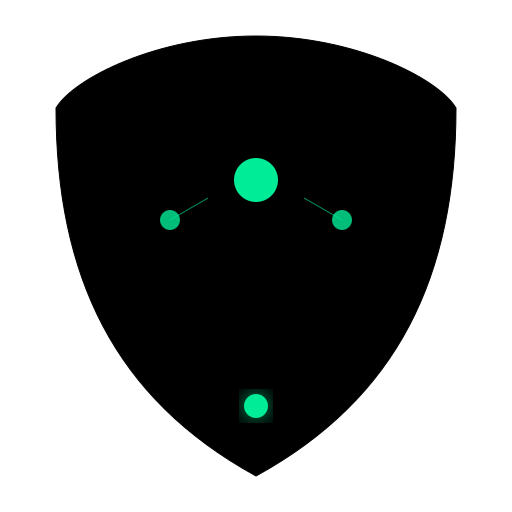
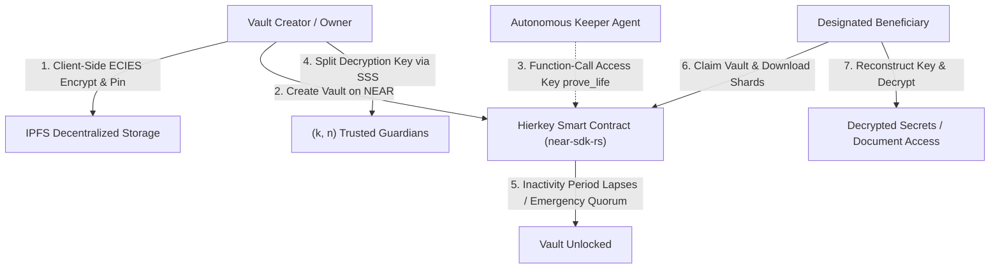

<div align="center">
  
  <br />
  <h1>Hierkey 🔐</h1>
  <p><strong>Autonomous Dead Man's Switch & Sovereign Document Custody Protocol on NEAR Protocol</strong></p>

[](LICENSE)
[](https://react.dev/)
[](https://near.org/)
[](https://docs.near.org/)
[](https://vitest.dev/)
[](https://nearhackathon.com)
</div>

<br />

## 🌟 Origin

> **Hierkey began as SpooVault, an earlier project of mine built on Stellar.**
>
> For the **NEAR Hackathon (Nov 2026)**, I rebuilt it on NEAR Protocol into **Hierkey**:
> - **Re-engineered Core Smart Contract in Rust (`near-sdk-rs` v5.5.0)**: Ported vault creation, configurable heartbeat intervals, autonomous proof-of-life checks, multi-guardian emergency release quorums, and beneficiary claim mechanics using native NEAR block timestamps and collections (`contracts-near/`).
> - **NEAR Wallet Selector Integration**: Integrated `@near-wallet-selector/core` and `@near-wallet-selector/modal-ui` supporting MyNearWallet, Meteor Wallet, HERE Wallet, and hardware signing.
> - **Scoped Function-Call Access Key Relayer**: Implemented an automated keeper relayer leveraging NEAR's unique native security primitive — Function-Call Access Keys strictly limited to `receiver_id: contract_id` and method `["prove_life"]` with finite gas allowances.
> - **Unified NEAR API Service Layer**: Built `near.service.ts` using `near-api-js` (v5+) to handle resilient RPC queries, view call evaluations, and transaction pipelines.
> - **Preserved Chain-Agnostic Cryptography**: Maintained end-to-end zero-knowledge security via client-side ECIES encryption, Shamir's Secret Sharing (SSS) `(k, n)` threshold key reconstruction, Argon2id key derivation, and IPFS decentralized storage.
> - **Refreshed Visual Identity**: Re-themed the interface to obsidian black with signature NEAR Green (`#00EC97`) accents.

---

## 🎯 Hackathon Tracks

Hierkey competes directly across two critical tracks:

### 1. `[ 06 / SEC ] AI Security & Defense: Trust, but verify`
- **Core NEAR Primitive**: **Function-Call Access Keys**
- **Architecture**: Gives an autonomous AI agent or automated keeper bot the ability to execute `prove_life` on a user's vault without giving it keys to funds or arbitrary contract calls. If the agent is compromised, the attacker cannot drain tokens, transfer ownership, or read confidential vault data.

### 2. `[ 03 / PRV ] Privacy & Private AI: Private by design`
- **Architecture**: All files and sensitive master encryption keys are encrypted client-side using ECIES and split into polynomial shares via Shamir's Secret Sharing. The NEAR smart contract orchestrates timing, threshold consensus, and authorization without ever receiving or storing plaintexts or private keys.

---

## 🏗️ System Architecture



---

## 🛠️ Smart Contract (`contracts-near/`)

The contract is built using `near-sdk` v5.5.0 in Rust.

### Contract Methods

#### Change Methods (Transactions)
- `create_vault(name, description, heartbeat_interval_sec, guardians, guardian_threshold, beneficiaries, authorized_keeper, metadata_cid)`: Initializes a new custody vault.
- `prove_life(vault_id)`: Records a proof-of-life heartbeat, resetting the countdown timer. Can be called by the vault owner or an authorized keeper.
- `approve_emergency_release(vault_id)`: Called by an approved guardian. If threshold approvals are reached, the vault unlocks immediately.
- `claim_vault(vault_id)`: Called by a designated beneficiary after the vault has lapsed or reached guardian quorum.
- `add_guardian(vault_id, guardian)`: Vault owner adds an additional guardian.
- `add_beneficiary(vault_id, beneficiary)`: Vault owner adds an additional beneficiary.
- `authorize_keeper(vault_id, keeper)`: Vault owner authorizes or revokes a keeper account ID for automated heartbeats.
- `terminate_vault(vault_id)`: Vault owner terminates the vault.

#### View Methods (Read-only RPC)
- `get_vault(vault_id)`: Returns full telemetry and status of a vault (heartbeat interval, remaining time, unlocked status, etc.).
- `get_vaults_by_owner(owner)`: Lists all vault views owned by an account.
- `get_vaults_by_beneficiary(beneficiary)`: Lists all vaults where an account is a designated beneficiary.
- `get_vaults_by_guardian(guardian)`: Lists all vaults where an account is a guardian.
- `is_vault_unlocked(vault_id)`: Returns boolean indicating whether a vault has lapsed or been unlocked by quorum.
- `get_claims(vault_id)`: Returns records of beneficiary claims.
- `get_guardian_approvals(vault_id)`: Returns list of guardians who approved emergency release.
- `get_total_vaults()`: Total count of registered vaults.

---

## 🧪 Testing & Verification

### Smart Contract Tests (`cargo test`)
Run unit tests verifying edge cases and security guarantees:
```bash
cd contracts-near
cargo test
```
**Test Coverage:**
- `test_vault_creation_and_heartbeat`: Verifies timestamp resets on `prove_life`.
- `test_dead_man_switch_expiration`: Verifies vault unlocks after timer lapses.
- `test_guardian_emergency_quorum`: Verifies threshold approvals unlock the vault before timer lapses.
- `test_authorized_keeper_can_prove_life`: Verifies authorized keepers can submit heartbeats while unauthorized accounts are rejected.
- `test_beneficiary_cannot_claim_before_lapse`: Verifies beneficiaries cannot claim locked vaults.

### WebAssembly Compilation
Compile release wasm for NEAR testnet:
```bash
cd contracts-near
cargo build --target wasm32-unknown-unknown --release
```
Artifact generated: `contracts-near/target/wasm32-unknown-unknown/release/hierkey_contract.wasm` (350 KB).

### Frontend Test Suite
```bash
npm run test
```

---

## 🚀 Deployment & Scripts

### 1. Testnet Deployment
Deploy the compiled Wasm contract to NEAR Testnet:
```bash
npm run deploy:near
```
*(Requires `NEAR_ACCOUNT_ID` and `NEAR_PRIVATE_KEY` set in `.env`)*

### 2. Autonomous Keeper Relayer
Run the scoped Function-Call Access Key keeper relayer:
```bash
npm run keeper:relay-near <vault_id>
```

---

## 🔑 Security Architecture: Function-Call Access Keys

NEAR Protocol natively supports scoped access keys. Hierkey utilizes this primitive to implement safe automated heartbeats:

```
┌────────────────────────────────────────────────────────┐
│ Vault Owner Account                                    │
│   ├─ Full Access Key (Stored securely by human owner)   │
│   └─ Function-Call Access Key                          │
│        ├─ receiver_id: "hierkey.testnet"               │
│        ├─ method_names: ["prove_life"]                 │
│        └─ gas_allowance: 0.25 NEAR                     │
└────────────────────────────────────────────┬───────────┘
                                             │
                        Delegated to Keeper  │
                                             ▼
                             ┌───────────────────────────┐
                             │ Automated Keeper Relayer  │
                             │ (Cannot drain funds)      │
                             │ (Cannot call claim_vault) │
                             │ (Cannot read secrets)     │
                             └───────────────────────────┘
```

---

## 📄 License
MIT License. Created for the NEAR Hackathon 2026.
